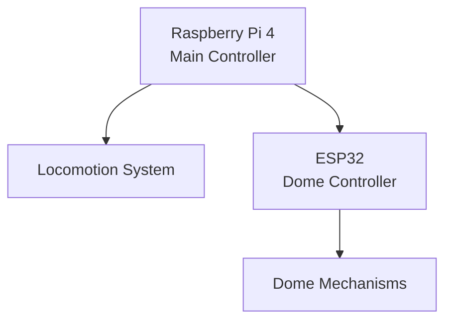
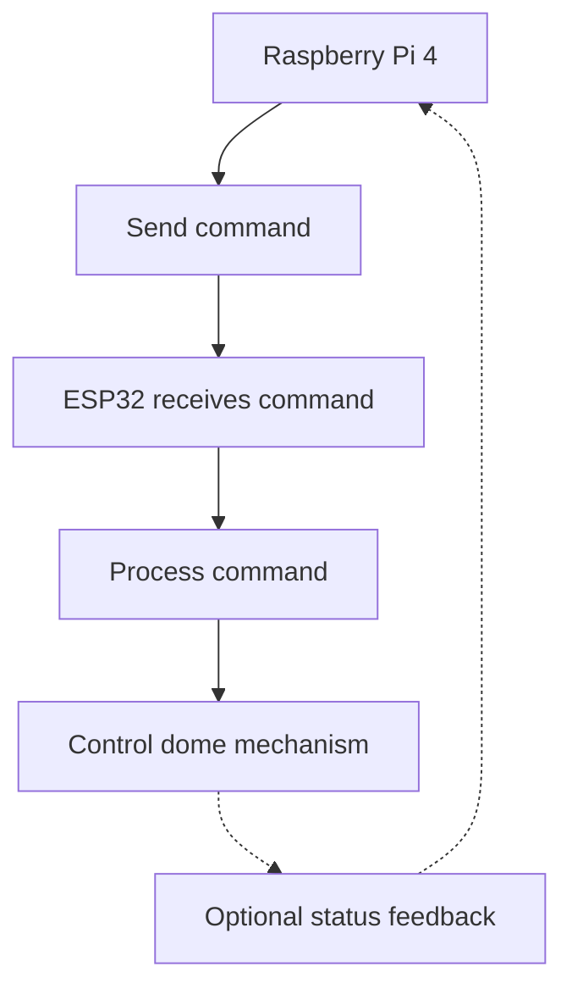

# System Diagrams

This document presents the planned architecture of the R2-D2 robot and the communication between its main controllers.

## 1. Overall System Architecture

The robot is organized around a main controller and dedicated hardware subsystems.

**Responsibilities:**

- **Raspberry Pi 4:** Coordinates the robot and sends commands.
- **Locomotion system:** Handles the robot's basic movements.
- **ESP32:** Controls the mechanisms installed in the dome.
- **Dome mechanisms:** Execute the actions requested by the ESP32.

The diagram represents the intended architecture. The exact interfaces and implementation details will be documented as development progresses.

## 2. Communication Between Controllers

The Raspberry Pi 4 will send commands to the ESP32. The communication method and protocol have not yet been finalized.

The dashed arrows represent a possible feedback mechanism. Status reporting will be confirmed during implementation.

## 3. Development Notes

These diagrams describe the planned system rather than a fully validated implementation.

They should be updated when:

- The controller responsibilities change.
- The communication method is selected and tested.
- New subsystems are integrated.
- A planned feature becomes operational.

Only validated behaviour should be documented as implemented.
